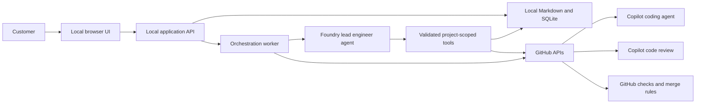

## 1. Product vision

Software Factory lets a customer build and evolve a software product without managing its
source code, engineering backlog, or pull requests.

The customer describes a business idea and works with a lead engineer agent to clarify it.
The agent maintains a business requirements document (BRD), devises an architecture and
delivery plan, manages a GitHub backlog, delegates implementation to GitHub Copilot, and
keeps the customer informed as the product takes shape.

The lead engineer agent runs on Microsoft Foundry. GitHub Copilot is the coding agent and
code reviewer. Software Factory coordinates their work; it does not introduce a second
coding agent or make the Foundry agent a code reviewer.

Software Factory runs locally with a browser-based UI. Project documents, conversations,
memory, and orchestration state persist on the user's machine. Assigned development work
runs on GitHub independently of the local application.

Status: Draft v0.1. Product requirements are captured below; proposed defaults and unresolved
decisions are identified explicitly. This is a seed specification for a new repository,
not an instruction to convert Bolt Reporter or implement Software Factory in this repository.

## 2. Goals

1. Translate business conversations into a versioned BRD and actionable engineering work.
2. Provide a customer-facing UI for creating projects, discussing goals, and tracking progress.
3. Maintain project understanding across conversations, application restarts, and code changes.
4. Create and manage epics, user stories, and implementation tasks in GitHub Issues and Projects.
5. Assign bounded implementation work to GitHub Copilot and track the resulting pull requests.
6. Request Copilot code reviews and coordinate follow-up work until changes meet delivery gates.
7. Keep the customer informed in business terms without requiring them to operate GitHub.
8. Reconcile work completed while the application was stopped and resume without duplicates.

## 3. Non-goals for the first version

* A hosted Software Factory service, shared database, or multi-user collaboration
* Work IQ, standup transcripts, Microsoft 365 integration, or email reporting
* Local code synthesis, local customer-repository execution, or a built-in code editor
* Code review or technical approval performed by the Foundry lead agent
* Support for source-control providers other than GitHub.com
* Organization-owned repositories or Projects boards in the first version
* Multiple repositories per Software Factory project
* macOS or Linux support in the initial release
* Runnable previews or preview hosting, which may be added later
* Unrestricted autonomous production deployment or cloud resource provisioning
* Automatic bypass of GitHub branch protections, organization policies, or required approvals
* Guaranteed correctness, production readiness, or completion without any human intervention

Software Factory should remove routine engineering management from the customer. Where GitHub
or a consequential business decision requires intervention, the application must explain the
blocker rather than pretend that the workflow is fully autonomous.

## 4. Actors and responsibility boundaries

### 4.1 Customer

The customer describes business goals, supplies domain knowledge, answers questions, approves
the initial delivery baseline, and requests changes. They use Software Factory rather than
GitHub to understand progress. They are not expected to write stories, inspect diffs, or review code.

### 4.2 Installation owner

The installation owner supplies Foundry configuration, connects a GitHub repository and PAT,
and handles account permissions or repository policies that Software Factory cannot change.
The owner may also be the customer. Technical setup is separate from ongoing product conversations.

### 4.3 Foundry lead engineer agent

The lead agent owns requirements elicitation, architecture, planning, backlog management,
delegation, progress awareness, and customer communication.

It may inspect repository structure, relevant files, PR descriptions, changed-file lists,
check results, and Copilot findings to understand the product's current state. Inspection
is for planning and situational awareness, not an independent code review.

It must not author application code, submit code-review verdicts, invent test results,
or approve a PR on behalf of a reviewer. Technical review findings come from Copilot and
configured automated checks.

### 4.4 GitHub Copilot coding agent

Copilot implements assigned work in the connected repository, writes tests and developer
documentation, and creates or updates PRs. It also implements fixes requested after review
or failing checks.

### 4.5 GitHub Copilot code reviewer

Copilot code review examines proposed changes and provides findings. Software Factory reads
those findings and routes actionable feedback to the coding agent. A review request, a
completed review, and an approving review are distinct events.

### 4.6 Local orchestration service

Application code, not the model alone, enforces project boundaries, permissions, action
policies, deduplication, retry limits, and merge gates. The model proposes and invokes
typed tools; the service validates every invocation.

## 5. User experience

### 5.1 Start and resume

1. The owner installs dependencies and supplies the global Foundry settings in `.env`.
2. A documented development/start command launches the local backend and UI.
3. The application opens or displays a loopback browser URL. It is not a CLI product.
4. Existing projects load from the local data directory.
5. Each project reconciles its GitHub state before the agent takes new external actions.
6. The customer resumes their prior conversation with the BRD, memory, and progress intact.

An application process hosts the orchestration worker. Closing a browser tab does not stop
that worker while the application process is running. Stopping the application stops local
planning, polling, and dispatch, but does not cancel work already assigned on GitHub.

### 5.2 Project list

The landing page lists existing projects and provides a New project button. Each project
shows its name, business summary, repository, delivery state, last successful sync, and
whether it needs customer input or technical intervention.

The UI must distinguish paused orchestration from development that may still be running
on GitHub. It must not label a cached snapshot as live.

### 5.3 Create a project

The creation flow collects:

* Project name and a short business description
* An existing, empty GitHub repository URL owned by the connected personal account
* A GitHub PAT entered through a masked control
* An initial BRD, supplied as Markdown, pasted text, or created through a guided conversation

The first version uses a personal GitHub account for both repository and board ownership.
Infer the board owner from that account. GitHub Projects belong to the account and can be
linked to a repository; they are not owned by the repository itself.

No board URL, ID, or owner is required as an additional configuration setting. After setup
authorization, the lead agent uses GitHub tools to create and link a personal Projects board
automatically. Selecting an existing personal board is an optional alternative.
The UI shows the resulting board link in project settings.

Before provisioning anything, show a connection checklist covering repository access,
issue and project permissions, Copilot availability, review support, billing prerequisites,
and applicable merge or workflow-approval restrictions.

Saving a draft project must remain possible when a prerequisite is missing. Execution stays
blocked with a specific explanation. Creating the project does not immediately dispatch work.

### 5.4 Project workspace

Opening a project exposes:

* Overview with delivered capabilities, current work, blockers, and next steps
* Chat with the lead engineer agent, including durable conversation history
* BRD with rendered Markdown, editing, revision history, and proposed changes
* Documents and memory with readable Markdown artifacts and their provenance
* Backlog and delivery view reflecting GitHub Issues, board state, and PR progress
* Settings with repository, board, credential status, and execution controls
* Activity history showing actions, failures, approvals, and external resource links

The exact tab arrangement is a design choice. Chat, the BRD, settings, and current progress
must be easy to reach without navigating GitHub.

### 5.5 Start, pause, and change direction

The customer explicitly starts delivery after reviewing the initial BRD and plan.
Starting delivery also authorizes automatic merging to `main` once PR approval and all
required gates are satisfied; no separate per-PR customer confirmation is required.
While running, the service continues orchestrating without requiring a chat message for
each action. Pause stops new dispatches and merge requests after any in-flight local action
has been reconciled. It does not imply cancellation of remote Copilot sessions.

When requirements change, the agent explains the effect on scope, completed work, active
PRs, and planned work. It records an approved change before publishing revised instructions.
Ordinary implementation sequencing within approved scope does not need repeated approval.

## 6. Requirements, architecture, and project memory

### 6.1 BRD as the business baseline

Every project has a local `BRD.md` containing:

* Business problem, intended users, and desired outcomes
* Product scope and explicit exclusions
* User journeys and functional requirements with stable identifiers
* Relevant quality, accessibility, privacy, and operational requirements
* Success measures and testable acceptance criteria
* Constraints, assumptions, dependencies, and unresolved questions
* Approved changes and their relationship to prior requirements

The agent should ask focused questions and identify uncertainty rather than silently invent
customer intent. A partial BRD is valid during discovery, but unresolved questions that
affect an implementation task must block that task from becoming ready.

### 6.2 Architecture and delivery plan

The lead agent derives a technical architecture and delivery plan from the BRD. These cover
components, data flows, interfaces, security boundaries, technical risks, validation strategy,
and incremental milestones.

Architecture decisions record their rationale and alternatives. Decisions with material
cost, privacy, or scope consequences require customer or owner approval. Implementation
choices within an approved architecture may be delegated to Copilot.

The technology stack of each generated customer product is selected for that project's
requirements. It is not forced to match Software Factory's own stack.

### 6.3 Durable memory

Project memory is explicit local state, not an assumption that a Foundry conversation will
remain available forever. It includes goals, customer preferences, terminology, decisions,
constraints, current understanding of the repository, and unresolved questions.

Each substantive memory entry identifies its source, date, and whether it is a confirmed
fact, approved decision, tentative interpretation, or superseded statement. Inferences
must not silently become requirements.

Before a new agent turn, the service assembles bounded context from the current BRD,
architecture, memory summary, recent conversation, relevant documents, and latest GitHub
snapshot. Older conversations can be summarized without deleting their persisted history.

The Foundry agent reads the local BRD and supporting Markdown through a custom, project-scoped
file-read tool executed by the local application. GitHub Copilot does not read those files;
the lead agent translates the relevant requirements into self-contained GitHub work items.

The customer can inspect and correct memory. Raw chat, summaries, and business documents
remain distinct. Superseded decisions remain traceable but are not presented as current.

### 6.4 Document lifecycle

The agent can create and revise project Markdown documents as understanding evolves.
Writes are project-scoped, atomic, versioned, and recorded in the activity history.
Concurrent UI edits must produce a visible conflict rather than silently overwriting text.

Proposed BRD changes remain drafts until approved. Approval records the exact revision;
approving one revision must not approve subsequent edits. Documents derived from an older
baseline are marked stale until reconciled.

The application must preserve useful local context independently of model-provider storage.
Credentials must never be embedded in documents, memory, or conversation exports.

## 7. GitHub backlog and delivery workflow

### 7.1 Bootstrap an empty repository

An empty repository may not have a default branch from which Copilot can start.
Use `main` as the default and integration branch for every project. After explicit setup
authorization, Software Factory may create `main`, set it as the default branch, and
commit a minimal README through GitHub APIs. Bootstrap does not upload the BRD or memory.

This is a narrow bootstrap exception, not permission for the lead agent to write application
code. Application scaffolding, tests, and CI definitions are subsequent Copilot tasks.
If GitHub policies prevent bootstrap, setup remains blocked with owner-facing instructions.

By default, the lead agent uses the service's GitHub tools to create a personal Projects
board, link it to the repository, and configure the backlog fields. If the owner optionally
selects an existing board, use that board instead. Persist the board ID, URL, and field
identifiers locally so subsequent runs reconnect without asking for board configuration.
Repeating setup must not create duplicate boards or issues. Missing Projects permissions
produce a setup blocker, not a requirement for the customer to create the board manually.

### 7.2 Translate requirements into work

The backlog has epics, user stories, and implementation tasks. Use GitHub Issues as durable
work records, with native hierarchy where supported and explicit parent links otherwise.
Projects provides status and prioritization views over those issues.

Every dispatchable task contains:

* Business outcome and linked BRD requirement identifiers
* Parent story or epic and relevant dependencies
* Bounded implementation scope and explicit exclusions
* Acceptance criteria and required verification evidence
* Architecture decisions and repository context needed for implementation
* The approved specification revision it implements

Only implementation-sized tasks are assigned to Copilot. Large epics and ambiguous stories
must be decomposed first. Dependencies form an acyclic graph; dependent work is not dispatched
until its prerequisites are delivered.

### 7.3 Hand off requirements through GitHub work items

The BRD, architecture notes, and project memory remain local. The Foundry agent reads them
through local file tools, determines the relevant work, and uses GitHub tools to create
or update the corresponding epics, stories, and implementation tasks.

Each assigned issue is a self-contained implementation brief: it includes the requirements,
acceptance criteria, constraints, relevant architecture decisions, and repository references
Copilot needs for that task. Links to local files or requirement identifiers alone are not
sufficient implementation instructions.

Copilot works from the assigned GitHub issue and accessible repository context. It does not
need access to the local BRD, a repository copy of the BRD, or a separately published
specification snapshot. There is no automatic document-mirroring requirement.

Record the source BRD revision and the dispatched issue-body revision or content hash locally.
This preserves traceability without exposing the source documents and prevents later BRD
changes from silently rewriting an in-progress task's contract.

Raw chats, private memory, credentials, and unapproved drafts are not copied into GitHub.
Only the selected context required for the work item is sent. The UI explains that issue
content is visible to users who can access the repository, especially for public repositories.

### 7.4 Dispatch implementation

The service selects ready tasks and assigns them to Copilot using supported GitHub APIs.
For the first version, issue assignment is the preferred integration because the issue is
the backlog's work contract. The agent tasks API is an alternative, not a second dispatch
for the same task.

Persist dispatch intent before the external call and capture the resulting assignment,
session identifiers when available, and PR links. An assignment request succeeding means
the work was accepted, not that implementation completed.

Proposed default: one active implementation task per project. This limits conflicting
changes while the first version proves its execution loop. Higher concurrency is deferred.
Different projects remain independently schedulable.

### 7.5 Observe progress without becoming the reviewer

Track issue state, Copilot session state where exposed, PR lifecycle, linked commits,
changed-file lists, checks, review requests, review findings, and merge status.

The lead agent maintains a repository understanding tied to observed commit SHAs. It updates
that understanding after merges and retrieves relevant files when needed for planning.
A stale repository summary must not be used as evidence of current behavior.

The agent reports what is implemented, under review, blocked, or awaiting verification.
It must not equate an open PR, closed issue, or Copilot session completion with delivered work.

### 7.6 Coordinate review and remediation

1. Detect the PR associated with the assigned task and the latest head SHA.
2. Establish that coding has completed sufficiently for checks and review.
3. Request Copilot code review, or observe a configured automatic review.
4. Collect review findings and required-check results for the current PR head.
5. Send actionable findings and failures to Copilot coding agent using a supported
   continuation mechanism, such as a PR-level instruction referencing the findings.
6. Track new commits, rerun checks, and request a new review when necessary.
7. Stop for intervention when limits are exhausted or no supported continuation is available.

Posting a reply to a Copilot review comment must not be assumed to start a coding session
or cause the reviewer to respond. The integration must verify the supported continuation
path. The lead agent can summarize and route findings, but cannot dismiss technical findings
using its own code-review judgment or silently resolve every review thread.

Proposed default: at most three automated remediation cycles per task before it is blocked.
Persistent failures, conflicting findings, missing credentials, and exhausted Copilot quota
are surfaced explicitly.

### 7.7 Merge and definition of delivered

Software Factory automatically merges approved, eligible PRs into `main` without the customer
managing PRs or enabling a separate merge policy. Starting delivery authorizes this behavior.
The service requests the merge through its GitHub tool only after every gate is satisfied.

Merge gates include:

* Implementation references the current approved task contract
* Required checks have completed successfully for the current PR head
* Required Copilot review has completed for that head and actionable findings are resolved
  or have an explicit, policy-permitted disposition
* A valid approving review is present for the current PR head; a comment-only review or
  completion of a review request is not approval
* All GitHub-required approvals and other repository rules are satisfied
* The PR targets `main`, is mergeable, is no longer draft, and has no unresolved scope-change hold
* No commits have appeared since the gate evaluation

Use expected-head-SHA checks or equivalent supported safeguards when merging. Unknown checks,
pending mergeability, stale approvals, and absent verification evidence are not success.
Bootstrap work must establish the expected checks; the absence of a configured test suite is
not proof that acceptance criteria pass.

The Foundry agent does not submit an approving review. The coding agent's ability to merge
its own work must not be assumed. GitHub policies can require workflow authorization, draft
transitions, or an additional eligible reviewer even when automated review is available.
If the verified integration cannot satisfy a gate, show a blocked state and the required
owner action. Never weaken protections automatically or fabricate approval.

A task is delivered only after its intended changes are merged and required evidence is
recorded. Parent stories and epics roll up completion from their acceptance criteria.
For the first version, the delivery target is code merged into `main`, not a runnable preview.
Preview hosting may come later. Merged code is not automatically deployed software or a
verified customer outcome.

### 7.8 Evolving requirements

An approved requirement change creates a new baseline and an impact assessment covering
pending tasks, dispatched work, open PRs, and already-delivered capabilities.

The lead agent may revise unstarted work, reprioritize tasks, or create follow-up work.
For active work, explicitly choose continuation, a supported cancellation, or superseding
work. Do not silently change the issue underneath an executing agent.

Already-merged behavior is changed through new tasks and PRs. Superseded issues retain links
to the requirement change and replacement work.

## 8. Persistence, synchronization, and recovery

### 8.1 Sources of truth

* Local approved documents define business intent and architecture decisions.
* GitHub defines actual issue, board, session, PR, check, review, and merge state.
* The local database stores conversations, document revisions, mappings, action history,
  cached snapshots, and recovery checkpoints.
* Foundry conversations are execution context, not the only copy of project memory.

The UI distinguishes intended backlog state from the last observed remote state.
Edits made directly in GitHub must be reconciled, not overwritten blindly.

### 8.2 While the application is running

A backend worker polls GitHub for active projects and invokes the lead agent when new
information requires planning or action. Every poll does not need a model call.

Proposed default: poll active work every 60 seconds with pagination, conditional requests
where supported, and rate-limit-aware backoff. Provide manual refresh.
Public webhook hosting is not required for the first version.

Use per-project leases or OS-backed locks so multiple browser tabs or application instances
cannot dispatch the same task concurrently. Persist action intent, outcome, and GitHub IDs.
After a timeout with an uncertain result, reconcile before retrying a mutation.

### 8.3 While the application is stopped

Already-started Copilot sessions, GitHub-hosted CI, and configured automatic review or
auto-merge may continue under GitHub's own policies. They can also stop at approval gates.

No new local planning, dispatch, remediation, or merge request occurs while Software Factory
is stopped. Persistent Foundry agent definitions do not make the local worker always-on.
Continuous autonomous orchestration while the application is off is out of scope.

### 8.4 Resume and reconciliation

On startup or reconnection:

1. Restore local project files, conversation history, and pending action records.
2. Fetch current GitHub work and relevant changes since the last successful sync.
3. Reconcile uncertain mutations before issuing new ones.
4. Refresh PR heads, checks, reviews, dependency state, and merged work.
5. Update repository understanding, progress summaries, and board mappings.
6. Resume eligible work only after reconciliation succeeds.

If GitHub is unavailable, local documents and past conversations remain readable.
New messages can be saved, but live progress claims and external mutations remain blocked
or explicitly pending. Credential errors must not become empty, success-shaped snapshots.

## 9. Architecture and implementation direction

### 9.1 Component boundaries



### 9.2 Proposed Software Factory stack

* Python backend with FastAPI, Pydantic settings, and the Microsoft Foundry SDK
* React and TypeScript browser UI
* Streaming chat and activity updates through server-sent events
* SQLite for transactional local state and Markdown for readable project artifacts
* Windows Credential Manager through the OS keyring for project PATs, with only credential
  references in project configuration
* GitHub REST and GraphQL clients behind a versioned integration boundary
* A worker hosted with the backend, without an external queue or scheduler service

These are proposed defaults, not inherited requirements from Bolt Reporter. Production
packaging can serve a built frontend from the backend; development may run separate processes
behind a same-origin proxy. A documented single start command should launch the full local UI.

### 9.3 Agent tools

Provide typed tools for reading and revising project documents, proposing BRD changes,
reading repository context, managing issues and board fields, dispatching Copilot work,
observing PRs and checks, requesting review, routing remediation, and conditionally merging.

The custom local file-read tool retrieves the BRD or supporting Markdown from the active
project's document root and returns its content and revision to the Foundry agent. The local
application executes the read; Foundry does not need direct filesystem access. Separate
GitHub tools let the agent turn that context into work items and assign them to Copilot.

Bind project, repository, board, and allowed document roots in server-side execution context.
The model must not supply arbitrary credentials, repository destinations, filesystem paths,
shell commands, or merge-policy overrides.

Reuse Foundry agent versions when their model, instructions, and tool schemas are unchanged.
Bound each agent run and persist its result or failure. Tools with side effects require
durable action records and policy validation independently of conversational wording.

## 10. Local data and configuration

### 10.1 Data directory

The initial release supports Windows. Use `%LOCALAPPDATA%\SoftwareFactory` as the per-user
data directory, with `SOFTWARE_FACTORY_HOME` as an override. Cross-platform support is deferred.

```text
SoftwareFactory\
  .env
  factory.db
  logs\
  projects\
    <project-id>\
      project.json
      BRD.md
      architecture.md
      delivery-plan.md
      memory.md
      decisions\
      documents\
      revisions\
```

The document names beyond `BRD.md` are conventions, not a requirement to create empty files.
The database contains durable chat and revision records; Markdown files expose current
readable artifacts. The owner must be able to back up both together.

`project.json` contains non-secret settings and references. No PAT is stored there.
Deleting or archiving a local project must not delete its GitHub repository, board, issues,
or PRs. Any local data deletion requires confirmation and explains remote work may continue.

### 10.2 Global Foundry settings

The installation owner supplies Foundry configuration in `.env`. Proposed variables are:

```dotenv
AZURE_AI_PROJECT_ENDPOINT=
AZURE_AI_MODEL_DEPLOYMENT_NAME=
SOFTWARE_FACTORY_AGENT_NAME=software-factory-lead
SOFTWARE_FACTORY_HOME=
LOG_LEVEL=INFO
```

Use a documented Azure credential flow supported by the selected SDK. `DefaultAzureCredential`
can use local Azure sign-in or service-principal environment variables such as `AZURE_TENANT_ID`,
`AZURE_CLIENT_ID`, and `AZURE_CLIENT_SECRET`. Document the required Foundry roles.
Do not assume an API key alone supports every agent-service operation.

Load process environment first, then a working-directory `.env`, then the data-directory
`.env`. Publish a placeholder-only `.env.example` in the new project.
Neither global credentials nor PATs are sent to the browser after initial entry or passed
to the model. The UI shows connection status, not secret values.

### 10.3 Minimum persisted entities

* Project identity, repository and board IDs, credential reference, and execution policy
* Document revision, approval, and content hash
* Conversation, message, summary, memory provenance, and decision
* Requirement, work-item mapping, parent relationship, dependency, and target baseline
* Copilot dispatch, linked issue or session, PR, observed head SHA, and remediation count
* Action intent, attempt, result, external IDs, error, and reconciliation state
* Sync checkpoint, snapshot timestamp, and customer-facing activity event

Business delivery state and technical execution state remain separate. A failed API call
does not mean a requirement failed, and a completed agent session does not mean a story shipped.

## 11. GitHub capability and permission contract

GitHub features, preview APIs, account entitlements, and organization policies evolve.
The integration must validate the configured account and repository rather than treating a
valid PAT as proof that Copilot, Projects, review, and merge are all available.

The current documented API surface includes issue assignment to Copilot and a separate
agent tasks API. Both are identified as public preview in GitHub's API usage guide.
Prefer a tested, pinned integration contract with capability checks and actionable errors.

For issue assignment, GitHub currently documents metadata read access and Actions, Contents,
Issues, and Pull requests read/write permissions for fine-grained PATs, or `repo` scope for
classic PATs. Projects access must be checked separately. GitHub's Projects GraphQL guide
documents `read:project` for classic-token reads and `project` for mutations.
Do not claim that a repository-only PAT automatically grants board management.

Copilot review has a documented REST request endpoint:
`POST /repos/{owner}/{repo}/pulls/{pull_number}/copilot-code-review`.
A pending request, denial due to entitlement or quota, and transient service failure must be
handled separately. Do not guess that adding a bot to the normal reviewers list is equivalent.

Copilot reviews are comments by default. Some configurations allow approving reviews that
count toward merge requirements; this must be verified for the target repository.
Additional rules for Copilot-authored PRs and Actions approval can still apply.

The owner receives a least-privilege permission checklist for the chosen supported token
type. Missing capabilities block only affected actions and remain visible in setup and
project settings. Do not store or request a second identity merely to bypass approval rules.

## 12. Safety, privacy, and operational requirements

### 12.1 Data boundaries

Local-first describes persistence, not offline inference. Selected business documents,
conversation context, and repository evidence are sent to Foundry through the local
application. The lead agent sends derived work-item instructions to GitHub for Copilot;
the local BRD and memory are not mirrored to the repository.

The UI explains these boundaries before execution. Creating work items in a public repository requires
an explicit warning. Logs must redact credentials and avoid raw business content by default.
Business files are not encrypted by the application in the first version; filesystem and
device protections remain the owner's responsibility.

### 12.2 Local application security

Bind to loopback by default. Protect local APIs against cross-origin requests, cross-site
request forgery, and unauthorized access by other browser origins. Do not treat loopback
binding alone as authentication. Use an installation-session authorization mechanism.

Sanitize rendered Markdown and treat chat, documents, issues, repository files, and review
comments as untrusted content. None can override tool permissions or approval policy.
Confine document access to the selected project's permitted paths, including symlink checks.

### 12.3 Bounded automation

Persist start, pause, approval, and merge-policy decisions. Stop new dispatch on persistent
authorization failures, dependency conflicts, exhausted retries, or exhausted service quota.
Use bounded retries with backoff and an explicit intervention state.

Show dispatch and remediation counts, active work, and available service-usage information.
Do not promise a dollar spending cap unless it can be enforced across both Foundry and GitHub.
No destructive GitHub operation, production deployment, or protection bypass is in the
first-version tool allowlist.

### 12.4 Observability and responsiveness

Every external mutation has an auditable action record and a visible result or pending state.
Every progress summary carries a last-sync timestamp and links to its evidence.
Long-running calls do not block UI navigation or document viewing.

Proposed targets: show chat activity within two seconds of accepting a message, and reflect
GitHub changes within two successful active polling intervals. These do not imply a bound
on model response time, Copilot queue time, CI runtime, or third-party availability.

## 13. First-version acceptance criteria

1. Starting the application on Windows opens a usable UI with a project list and New project flow,
   without requiring routine CLI interaction.
2. A customer can create a project from an empty repository, PAT, and draft BRD; missing
   permissions produce explicit setup blockers without losing the draft. With the required
   permissions, the agent automatically creates and links a personal Projects board,
   configures its backlog fields, and saves its ID and URL locally without additional
   required board configuration. Project settings show the board link, and restarting
   does not create another board. Selecting an existing board remains optional.
3. Chat history, BRD revisions, and corrected project memory survive a full application restart.
4. An approved baseline produces traceable epics, stories, and bounded tasks in GitHub,
   with the repository and linked Projects board owned by the connected personal account.
5. Empty-repository bootstrap establishes `main` as the default branch without the Foundry agent
   generating application code.
6. The Foundry agent reads the local BRD through a project-scoped file tool and creates
   self-contained GitHub work items. Copilot implements from those items without reading
   the local BRD or requiring a mirrored specification. Drafts and secrets are excluded.
7. Starting delivery dispatches an eligible task once. Repeating reconciliation after an
   interrupted or timed-out assignment does not create duplicate work.
8. A PR triggers Copilot review and, when needed, a bounded remediation cycle delegated
   to Copilot coding agent. The lead agent submits no code-review approval or verdict.
9. A new PR head invalidates prior local gate evaluation. Pending, failed, or missing
   required checks prevent a merge request.
10. With a verified supported repository policy, an approved PR automatically merges into
    `main` once all gates pass, without per-PR customer confirmation or a runnable preview.
    A comment-only review does not trigger merging. An unsatisfied approval rule produces
    a blocker, not an automatic bypass.
11. Work can complete on GitHub while the application is stopped. Restart reconciles
    that work before dispatching or reporting new progress.
12. An approved BRD change updates pending work and explicitly handles affected active PRs;
    no executing task silently changes specification revision.
13. Pausing prevents new dispatches and merge requests while preserving visibility into
    previously started remote work.
14. PAT expiration, Projects denial, Copilot quota exhaustion, and network loss preserve
    local data and expose actionable errors.
15. Attempts to cross project boundaries, publish secrets, execute repository instructions
    as policy, or call local APIs from an unauthorized origin are rejected.

Use automated adapter and state-machine tests for repeatability, plus an opt-in live test
against a disposable repository and board. Live tests must verify the complete
issue-to-Copilot-to-review-to-merge path using the intended token and policies.
Do not declare unattended delivery supported solely from mocked API tests.

## 14. Delivery milestones

### M0: Prove GitHub integration

Use a disposable personal-account repository and Projects board to verify PAT permissions,
empty-repository bootstrap to `main`, Copilot assignment, review requests, remediation
continuation, draft transitions, workflow authorization, and automatic merging after approval.
Record supported and blocked paths before promising full autonomy.

### M1: Local workspace and discovery

Deliver Windows application startup, project list, creation/settings flows, secret storage, Foundry
chat, durable conversations, BRD editing, memory, and document revision history.

### M2: Planning and backlog

Deliver baseline approval, architecture and planning documents, requirement identifiers,
local file-read tools, GitHub board provisioning, issue hierarchy, dependencies, and
self-contained implementation briefs derived from the local BRD.

### M3: Orchestrated implementation

Deliver explicit start/pause, dispatch, polling, PR observation, review requests, remediation
limits, merge gates, and business-facing progress summaries.

### M4: Recovery and hardening

Deliver restart reconciliation, uncertain-action recovery, edit conflicts, cross-project
isolation, local API protections, backups, audit views, and end-to-end acceptance verification.

## 15. Confirmed decisions, proposed defaults, and open questions

The following decisions are confirmed:

* Use a personal GitHub account for repository and Projects board ownership.
* Create and link the Projects board automatically, with no additional required board
  configuration. Selecting an existing personal board is optional.
* Use `main` as the default and integration branch.
* Automatically merge PRs after approval and successful required checks, subject to all
  repository rules, without separate per-PR customer confirmation.
* Deliver code to `main`; no runnable preview is required for the first version.
* Build and validate the initial release for Windows. Other operating systems and previews
  may be considered later.

The following are proposed defaults, not additional confirmed customer requirements:

* Use Python/FastAPI and React/TypeScript for Software Factory itself.
* Start delivery only after approval of the initial BRD and plan.
* Begin with one active implementation task per project and three remediation cycles.
* Use polling while the application process is running, without a hosted webhook receiver.
* Store PATs in the OS keyring and local operational state in SQLite.

Resolve these questions during refinement:

1. Which PAT type provides the verified end-to-end permission set for the personal repository
   and personal Projects board?
2. Which GitHub policy configuration permits the desired review and merge workflow,
   and what owner intervention remains unavoidable?
3. How should the agent support DS-specific work requiring datasets, experiments, or compute
   beyond a GitHub coding environment?
4. Which business changes require renewed approval versus execution within existing scope?
5. What Windows packaging and installation experience should the first distribution provide?

## 16. GitHub integration references

Checked on 2026-11-16. Revalidate during M0 because preview contracts and policies may change.

* [Using Copilot cloud agent via the API](https://docs.github.com/en/copilot/how-tos/use-copilot-agents/cloud-agent/use-cloud-agent-via-the-api)
* [Using GitHub Copilot code review](https://docs.github.com/en/copilot/how-tos/use-copilot-agents/use-code-review)
* [REST API endpoints for Copilot code review](https://docs.github.com/en/rest/pulls/copilot-code-review)
* [Using the API to manage Projects](https://docs.github.com/en/issues/planning-and-tracking-with-projects/automating-your-project/using-the-api-to-manage-projects)
* [Copilot cloud agent risks and mitigations](https://docs.github.com/en/copilot/concepts/agents/cloud-agent/risks-and-mitigations)
