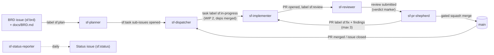

## Overview

This folder re-implements the Software Factory loop (see the root [SPEC.md](../SPEC.md)) on
GitHub-native pieces only:

* **Copilot cloud automations** (public preview) run every role, including the coding: each
  automation run is a Copilot cloud agent session started by a GitHub event.
* **GitHub Agentic Workflows (gh-aw)** runs the optional hve-core `/review` workflow.
* **APM (Agent Package Manager)** links reusable skills and agents from upstream repos with
  pinned revisions.

Nothing runs on your machine and nothing in `backend/` or `frontend/` is used. Those folders are
the original local app and are left untouched as the legacy implementation.

> [!IMPORTANT]
> This is an experiment. Read [GAPS.md](GAPS.md) before relying on it. One step still needs a
> person: approving CI runs that GitHub holds for agent-pushed commits.

## Architecture

Stages never call, assign or `@mention` each other. Each stage changes GitHub state (a label, a
PR, a review), and that event is the next stage's trigger. GitHub is the bus and the only memory.



| Automation | Prompt | Started by | Hands off by |
| --- | --- | --- | --- |
| `sf-planner` | [planner.md](prompts/planner.md) | issue labelled `sf:plan` | creating `sf:task` sub-issues with acceptance criteria and dependencies |
| `sf-dispatcher` | [dispatcher.md](prompts/dispatcher.md) | task opened or closed, PR merged, hourly | moving tasks whose dependencies merged from `sf:ready` to `sf:in-progress`, up to WIP 2 |
| `sf-implementer` | [implementer.md](prompts/implementer.md) | task labelled `sf:in-progress`; PR labelled `sf:fix` | pushing code (`report_progress`), opening the PR, labelling it `sf:review` |
| `sf-reviewer` | [reviewer.md](prompts/reviewer.md) | PR labelled `sf:review` | submitting a review with inline findings and a verdict marker (hve-core `code-review` skill) |
| `sf-pr-shepherd` | [shepherd.md](prompts/shepherd.md) | review submitted, CI failed, merge conflict, hourly | labelling `sf:fix` with a findings comment (max 3 rounds), or squash-merging when gates pass |
| `sf-status-reporter` | [reporter.md](prompts/reporter.md) | daily | rewriting the `sf:status` issue |

Triggers that fire on another automation's events set `allow_copilot_triggers`. Every stage is
idempotent, so duplicate or replayed events are harmless.

An earlier version assigned issues to Copilot and posted `@copilot` fix requests from inside an
automation. GitHub doesn't start a Copilot session when another agent session assigns or mentions
it (the assignment fails with a misleading "repository ruleset violation" error). Starting each
stage from an event avoids that and keeps every handoff visible on the issue or PR timeline.

Every prompt is prefixed with [_conventions.md](prompts/_conventions.md), which defines the label
state machine, hidden markers, policy constants (WIP 2, remediation cap 3) and hard rules.

### Label state machine

`sf:brd` → `sf:plan` → `sf:planned` on the BRD issue. Each `sf:task` issue moves through
Todo (no status label) → `sf:ready` → `sf:in-progress` → `sf:in-review` → `sf:done`, with
`sf:blocked` whenever a person must act. Factory PRs carry `sf:pr`, plus `sf:review` or `sf:fix`
while the reviewer or implementer owns them. Labels stand in for the original Projects v2 Status field
because automations have no Projects v2 tool.

## Install

Prerequisites: a **private or internal** repository (making a repository public turns its
automations off: the configuration reports `automations_enabled: false` and the API returns 404),
a Copilot plan with cloud agent and automations enabled, and `gh` authenticated as the account the
automations should act as and bill.

```powershell
gh api user --jq .login                       # confirm the identity first
./automations/install.ps1 -Repo owner/repo    # create or update automations and sf:* labels
./automations/install.ps1 -Repo owner/repo -Disable   # pause all of them
```

`install.ps1` is idempotent. It reads [definitions/](definitions/), concatenates the prompt files,
and creates or updates each automation by name through the automations REST API
(`/agents/repos/{owner}/{repo}/automations`, API version `2026-03-10`). Each definition sets a
per-run AI credit limit (`run_limit_credits`, 30 for each, the API minimum) and a daily limit
(`daily_limit_credits`, 30 to 100). Automations
are stored outside Git, so these files are the source of truth: edit them and re-run the script.

Then copy the files in [template/](template/) into the target repository (see
[Provenance and updates](#provenance-and-updates)), add a BRD as `docs/BRD.md` and as an issue
labeled `sf:brd`, and add `sf:plan` to that issue.

## Provenance and updates

Reusable agent primitives are **linked, not copied**. [template/](template/) holds the files the
target repository needs:

| File | Purpose |
| --- | --- |
| [apm.yml](template/apm.yml) | Declares upstream skills and agents, tracking `main` |
| [apm.lock.yaml](template/apm.lock.yaml) | Pins the exact commits (`resolved_commit`) and content hashes |
| [.github/workflows/pr-review.md](template/.github/workflows/pr-review.md) | hve-core's gh-aw review workflow, added with `gh aw add ...@<sha>`; `source:` records the origin. Compile with `gh aw compile` |
| [.github/workflows/sf-deps-update.yml](template/.github/workflows/sf-deps-update.yml) | Weekly: `apm install --frozen`, `apm update --yes`, `gh aw update`, then a PR |
| [THIRD_PARTY_NOTICES.md](template/THIRD_PARTY_NOTICES.md) | Attribution for linked sources |
| [BRD.md](template/BRD.md) | The tiny BRD used in the live run |

Linked sources:

| Source | Item | Used by |
| --- | --- | --- |
| microsoft/hve-core | `skills/shared/untrusted-content-boundary` | every automation (`_conventions.md`) |
| microsoft/hve-core | `skills/project-planning/backlog-management`, `backlog-plan` | planner |
| microsoft/hve-core | `skills/coding-standards/code-review` | gh-aw `pr-review` |
| microsoft/hve-core | `agents/project-planning/brd-builder.agent.md` | BRD refinement in the Copilot app or VS Code |
| microsoft/hve-core | `.github/workflows/pr-review.md` (gh-aw) | optional `/review`; shepherd reads `needs-revision` |
| andrejpk/andrej-agent-kit | `plugins/gh-orchestrator` skills `orchestrate`, `issue-intake` | interactive orchestration from the Copilot app |

`apm install` deploys skills to `.agents/skills/` and agents to `.github/agents/`. Treat that
output as generated. To change an upstream item, contribute upstream or override it in our own
prompts; do not edit the generated files.

Update flow:

1. `sf-deps-update.yml` runs weekly or on demand. It restores the locked state, runs
   `apm update --yes` and `gh aw update` (a 3-way merge that keeps local edits such as our
   skill-path retargeting in `pr-review.md`), recompiles, and opens a PR.
2. Opening that PR requires a `SF_DEPS_TOKEN` secret (a fine-grained PAT with contents, pull
   requests and workflows write), because the default `GITHUB_TOKEN` cannot write to
   `.github/workflows`. Without the secret the workflow only reports the diff.
3. Generate `apm.lock.yaml` on Linux with the pinned `apm-cli` version. A lockfile produced on
   Windows has different content hashes and fails `apm install --frozen` in CI.

Dependabot and Renovate don't understand `apm.yml`, so the scheduled workflow is the update path.

## Live run

The loop ran end to end in the private sandbox
[andrejpk/sf-automation-sandbox](https://github.com/andrejpk/sf-automation-sandbox) on a
three-task CLI BRD. One task completed the whole cycle, including one remediation round, and
merged as PR #5. [GAPS.md](GAPS.md) records each step and where a person had to intervene.
