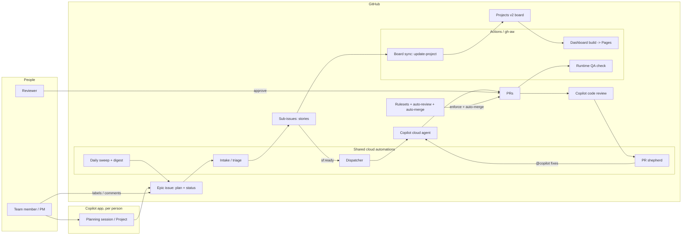

# Software factories on GitHub: analysis for an internal pilot

Date: 2026-11-20. Status: **draft v1**. Section 6 waits on the child session's live automation run.

## 0. TL;DR

> **Live test update (§6):** the automation-only loop worked once from start to finish, for about 8 AI credits, but a person had to step in three times. Copilot doesn't respond to automation-issued assignments or `@copilot` comments, and held CI runs can't be approved by an automation. Use **gh-aw with a user or bot PAT** for those steps, use automations for planning and status, and run the pilot in an **org** repo so rulesets enforce the gates.
> **v2 update (§6.1):** an event-driven version that lets an automation write the code (no Copilot hand-off) merged three PRs, including a full fix-and-re-review cycle. The only remaining manual step is releasing held CI runs. Automations need a private or internal repo.

- **The automations layer can replace most of the backend.** GitHub's cloud automations now trigger on nearly every event Lucas's poller watches: review submitted, ready_for_review, workflow failed, merge conflict, merged, sub-issue added, label added, and automation completed. They can also call the PR lifecycle tools that need: mark ready, request reviewers, merge, comment, sub-issues, and retry runs. With GitHub Actions and gh-aw added, **GitHub can be the backend**. Actions is the hosted compute you're already allowed to use.
- **Three things don't move cleanly:**
  1. **Code-enforced gates become prompt rules.** Fix this by making GitHub enforce them: rulesets, required checks, Copilot auto-review, and auto-merge or a merge queue.
  2. **Persistent lead conversations.** Cloud runs are stateless, so state must live on GitHub. gh-orchestrator already works this way.
  3. **The customer-facing UI.** GitHub has no "factory cockpit".
- **Copilot app Projects** are the personal cockpit and the interactive lead. Projects plus child sessions plus `send_session_message` reproduce the T3 Code thread model almost 1:1. They are per-user and local, though, so they're where *you* plan, not where *the team* runs.
- **Factory.ai's real moat** is Mission Control and orchestrator/worker/validator roles, multiplayer sessions, cost attribution per feature, a runtime QA validator, and delegation from chat. Enterprise governance is *not* much of a moat, because GitHub is strong there.
- **Pilot recommendation:** a "GitHub-is-the-backend" factory in a real team repo.
  - Shared automations handle broker/dispatch/shepherd.
  - gh-aw and Actions handle the deterministic parts.
  - Your gh-orchestrator skills become repo skills.
  - Humans participate through issues, labels, comments and PR approvals.
  - Each person uses the Copilot app as their own cockpit.
- **Start from [microsoft/hve-core](https://github.com/microsoft/hve-core), not from scratch (see §4.3a).**
  - It already ships the factory's stations as gh-aw workflows: `issue-triage`, `issue-implement` (`agent-ready` label → PR), `pr-review`, and a sharded `backlog-groom` orchestrator.
  - It has BRD → PRD → backlog agents with a GitHub executor, the RPI lifecycle skills, and a code-review skill.
  - **It has Copilot app canvases (RPI Workflow, Code Review, Session Log).** The RPI canvas can already follow every local session a Copilot app Project coordinates. That is a first version of the "factory cockpit".
  - Reuse those pieces and extend them. Build only the parts hve-core lacks: dispatch with WIP and dependency order, the PR shepherd loop, and the epic dashboard.

## 1. The four systems side by side

The GitHub-native column describes the fork branch [`copilot-automations-layer`](https://github.com/andrejpk/software-factory/tree/copilot-automations-layer), as it ran live in the sandbox (§6).

| Concern | Lucas's Software Factory (this repo) | Lucas's SF, GitHub-native fork (`automations/`) | Your gh-orchestrator (T3 Code) | Factory.ai |
|---|---|---|---|---|
| Lead / orchestrator | Foundry agent in a local FastAPI app | Cloud automations on GitHub's models: `sf-planner` (BRD issue → task sub-issues), `sf-dispatcher`, `sf-pr-shepherd`, `sf-status-reporter` | Per-epic T3 thread (Opus high), plus a broker thread (Opus low) | Mission Control orchestrator agent |
| Coders | Copilot cloud agent (assigned issues) | v1: Copilot cloud agent, but it doesn't start when an automation assigns it. **v2: an implementer automation writes the code itself** | Child T3 worktree threads (local agents) | Worker Droids |
| Review | Copilot code review; findings sent back via `@copilot` comments | v1: Copilot ignored `@copilot` comments written by an automation. v2: the reviewer posts findings and adds the `sf:fix` label, the implementer pushes a fix, and the reviewer checks again | Cross-model reviewer child; human reviews and merges | Validator role plus Code Review |
| Event intake | 60 s poller | Automation triggers (issue/PR/label/review events) plus an hourly sweep. Copilot finishing, its review arriving, and CI succeeding have no trigger | GitHub webhooks into T3 tasks; daily sweep | Delegations (Slack, Teams, Linear, Jira) plus Automations |
| State | SQLite plus local Markdown (BRD, memory) | **GitHub only**: BRD issue, sub-issues, `sf:*` labels, status issue | **GitHub only**: labels, marker comments, pinned plan comment, issue-body status; ledger on a branch | Factory cloud |
| Gates | **Code** (`gates.py`): head-SHA match, clean review, checks, approval path | **Prompt rules** in the shepherd; rulesets were unavailable on a personal Free-plan private repo. One wrongful block happened | Human merges; lead reviews against the plan | Validator plus autonomy levels |
| UI | Custom React: chat, BRD, backlog, settings | None built in. The view is spread across issue lists, the Agents tab, PR timelines and the status issue; there's no Projects board tool. A Mission Control Pages SPA is designed but not built | T3 threads, GitHub issues, Artifact dashboard (hill-climb) | Factory App: Mission Control, Workstreams, multiplayer |
| Multi-user | No (explicit non-goal) | Yes in principle: anyone with repo access works through issues and PRs (shared automations would act as Copilot) | Partly (anyone on the issue; thread links open for people with T3 access) | Yes |
| Cross-repo | No | No (automation tools are scoped to one repo) | Yes (leads label sub-issues in other repos; cross-thread messaging) | Yes |
| Hosting | Your laptop | **Nothing hosted**: GitHub automations, Actions and cloud agent | Your laptop or T3 environment | SaaS, private VPC, or air-gapped |
| Reuse and provenance | Self-contained | hve-core and andrej-agent-kit linked through APM plus `gh aw add @sha`, with a weekly update PR | Plugin in andrej-agent-kit | Proprietary |
| Cost seen | Foundry tokens plus Copilot | About 7.9 AI credits for 15 automation runs, plus Copilot coding and review sessions | Local model usage plus Copilot | Per seat or usage, with attribution per session, PR and ticket |
| Human steps needed | Approve and merge | v1: approve, plus three workarounds. **v2: only releasing held CI runs** (PRs #8–#10 merged through the chain) | Merge | Configurable autonomy |

**How the ideas connect:**
- Lucas's design is strongest on **delivery-loop rigor**: head-SHA-pinned gates, held-run handling, the remediation cap, and an honest "merged ≠ delivered" rule.
- Yours is strongest on **orchestration shape**: layered leads, intake → initiative → hill-climb escalation, children starting through labels, GitHub as the single source of truth, and agent-to-agent messaging.
- Factory.ai is strongest on **packaging**: one cockpit, one identity, cost and validation built in.
- The pilot should take Lucas's loop rigor and your orchestration shape, and run them on GitHub's automations and Actions.

## 2. Q1: How do Copilot app Projects relate to Lucas's build, and can we drop our own backend?

### 2.1 What the Copilot app gives you today
- **Projects** (public preview) hold a goal, a coordinator conversation, child sessions, a Library and recurring automations. The Overview groups work as **Needs input / Open / Working / Done**. That is close to Lucas's Backlog view and to a Factory Workstream.
- **Child sessions plus messaging.** A coordinator can create sessions and message them, and children report back. This is what I'm using right now to run the child Opus session. It is functionally T3's `t3_thread_send` and thread tooling, available on an internally approved tool.
- **Session automations** wake an existing session on a schedule (minutes or cron), keeping its context. **Cloud automations** start fresh cloud-agent sessions on GitHub events.

### 2.2 Mapping Lucas's backend onto GitHub-native pieces

| Backend responsibility (SPEC section) | GitHub-native replacement | Fidelity |
|---|---|---|
| BRD chat with the lead (§5.4, §6) | A Copilot app Project conversation (personal), **or** a BRD issue/discussion thread plus `docs/BRD.md` in the repo (team) | Good. Team-visible only in the issue variant |
| Create task issues on the board (§7.2) | Automation tools `create_issue`, `add_sub_issue`, `set_issue_fields`; gh-aw `update-project` for Projects v2 Status | Good. Automations have **no Projects v2 item tool**, so the board needs gh-aw, or issue fields and built-in board workflows |
| Dispatch with WIP limit and dependency DAG (§7.3) | Trigger "issue labeled `sf:ready`" plus "issue closed" plus a schedule sweep. `update_issue_assignees` assigns Copilot, or gh-aw `assign-to-agent`. Use native blocked-by links | Good. Assigning Copilot from an automation is **unverified** (child is testing). WIP is counted by the model, not a lock |
| Wait for session, mark ready (§7.4.2–3) | Trigger "PR opened/synchronize" or "automation completed"; tool `update_pull_request_draft_state` | Good |
| Start held workflow runs (§7.4.4) | Turn off "require approval" for Copilot PRs (simplest). Otherwise gh-aw `approve-workflow-run`. The automation tool `retry_workflow_run` covers failed jobs only | OK |
| Request Copilot review (§7.4.5) | **Ruleset: automatic Copilot review on push.** Better than requesting it from an agent | Better than custom |
| Route findings to `@copilot` (§7.4.7) | Trigger "PR review submitted (commented/changes_requested)"; tool `add_issue_comment` | Good, if Copilot-authored reviews can trigger automations ("Can be triggered by: People and Copilot"). **Unverified** |
| Remediation cap of 3 (§7.4.10) | A hidden marker comment counted by the prompt, or a label like `sf:cycle-2` | Prompt-enforced |
| Merge gates with expected head SHA (§7.5) | **Ruleset (required checks, required review, Copilot review) plus auto-merge or a merge queue.** GitHub enforces the gate, and the agent only enables auto-merge | **Stronger** if moved to rulesets; weaker if left in a prompt |
| Approval path (§7.5) | Shared automations act as Copilot, which needs an extra approval. Personal automations act as you, and you can't approve your own. **For a team pilot, a human teammate approves.** That is the participation you want anyway. Alternatively, enable Copilot approvals | Changes the model: human-in-the-loop by default |
| Polling and resume after restart (§8) | Event triggers plus a daily sweep; no process to restart | Better (nothing runs on a laptop) |
| SQLite, memory.md (§6.2, §8) | GitHub artifacts: issue bodies, a pinned plan comment, labels; automation **group artifacts**; gh-aw `repo-memory` branch | Good (your gh-orchestrator already proves the pattern) |
| Local React UI (§5) | See §3. This is the real gap | Weak |

**Answer:** yes, the delivery loop can run without your own backend. The backend splits into three layers:
- **GitHub settings** (rulesets, auto-review, auto-merge) for the gates;
- **shared cloud automations** for the event-driven agent steps;
- **gh-aw and Actions** for the steps that must be deterministic or need Projects v2 or held-run approval.

The interactive lead (BRD shaping, planning) stays a conversation: in the Copilot app per person, or on an issue for the team.

### 2.3 Copilot app vs cloud automations: which one is the "lead"?
- **Copilot app session/Project as lead:**
  - Pros: persistent context, rich steering, child sessions, the closest match to your T3 setup.
  - Cons: it runs on one person's machine, so it stops when the laptop sleeps. It is per-user and can't ingest webhooks (it polls via session automations).
- **Cloud automation as lead:**
  - Pros: always on, event-driven, team-shared, Copilot identity, visible to everyone with repo read access.
  - Cons: each run is a fresh session, so state must be re-read from GitHub. There is no live back-and-forth with workers; you steer through comments and labels. Definitions are not versioned in Git (gh-aw is).
- **Recommendation:** use a hybrid.
  - Plan interactively in the Copilot app, which writes the plan to the epic issue.
  - Run execution through shared cloud automations that read the plan from the issue. This is exactly gh-orchestrator's "all state is on GitHub" rule, so its skills port well.

## 3. Q2: Where GitHub's built-in UI falls short of Factory.ai (and the UI story)

### 3.1 What GitHub does well enough today
- **Projects v2 board** with Status, iteration and custom fields, sub-issue progress, blocked-by links, saved views, and charts. It is a decent team backlog.
- **Issue and PR timeline** as the audit trail. It shows Copilot session links, review threads and check runs, so everyone can see why something happened.
- **Agents tab and automation runs.** Session logs and prompts are visible to anyone with repo read access, which gives transparency for free.
- **Copilot app Project Overview** (Needs input / Open / Working / Done) as a personal mission control.
- **Governance:** enterprise policies, audit log, model policies, AI credit budgets and per-automation limits. GitHub is **on par or ahead** of Factory here for us.

### 3.2 Gaps compared with Factory.ai

| Factory.ai capability | GitHub today | Gap severity | Workaround |
|---|---|---|---|
| **Mission Control.** One view of an epic: milestones, workers, validators, credits, elapsed time, drill-down into each worker's terminal | Spread across board, issue, PRs, Agents tab and Copilot app (per-user) | **High** | Epic issue body as the status page (gh-orchestrator `lead-status` markers); Projects view per epic; generated dashboard (below) |
| **Multiplayer live sessions.** The team shares one live agent session and answers prompts together | Cloud sessions are read-only to others; steering goes through `@copilot` comments; Copilot app sessions are single-user | **High** for "team works in the factory" | Make issues and PRs the shared surface: questions go to issues, decisions go to comments. This is your existing rule |
| **"Waiting on you" inbox** across agents | GitHub notifications plus a Projects filter (`label:sf:needs-input`); the Copilot app's Needs input is per-user | Medium | Standard label `sf:needs-input` plus a saved Projects view per person; daily digest automation |
| **Validator role / runtime QA** before work advances | Copilot code review is static review only; nothing runs the app as a user | **High** for quality | `ready_for_review` automation that runs Playwright or screenshots; required check; a cross-model reviewer automation (as in your hill-climb) |
| **Cost attribution** per session, PR, ticket and epic | Org and user usage reports; per-automation credit limits; no roll-up per epic | Medium | Automation writes run cost to a ledger; `gh aw logs/audit` for gh-aw runs |
| **Delegation from Teams, Slack, Linear or Jira** under one agent identity | Copilot has Slack and Teams integrations for cloud agent **[unverified current state]**; automations trigger via API; gh-aw has experimental Jira/Linear/ADO connectors | Medium | Teams → Power Automate → automation API trigger, or an issue-creation bot |
| **Planner/worker/validator with model choice per role** | Model and reasoning are chosen per automation, so roles map to automations | Low | One automation per role |
| **Agent Readiness scoring, AutoWiki** | Nothing built in | Low to medium | Scheduled automations: "readiness report" issue; docs-refresh PRs |
| **Persistent environments and computers** | Cloud agent uses Actions runners plus `copilot-setup-steps.yml`; self-hosted runners possible | Low to medium | Larger or self-hosted runners for heavy builds and devices |
| **Live agent-to-agent messaging** (orchestrator ↔ workers) | Cloud agent sessions can't message each other; the Copilot app can, but only locally | Medium | Talk through GitHub artifacts (labels, comments); accept the latency |

### 3.3 The UI story without a backend (ranked by effort)
1. **Zero build:** a Projects v2 board with views ("My needs-input", "In flight by epic", "Blocked"), the epic issue body as the status page, and the Copilot app Project per person. It works on day one and is how the team participates.
2. **Static dashboard on GitHub Pages:** a scheduled Action renders the board, PR states, cycle counts and costs into HTML, like your `climb-report.mjs` and hill-climb dashboard. In an internal org, Pages can be internal-only. No backend; reuses your report code.
3. **Copilot app canvas extension:** a "Factory" canvas in the Copilot app that reads GitHub with the user's own auth and shows Mission Control for an epic. It gets close to Factory's cockpit, runs inside an approved tool, and has nothing to host.
   - **hve-core already proves the pattern.** Its RPI Workflow canvas follows the sessions a Copilot app Project coordinates, shows each one phase by phase, and sends your decisions back to that session. Code Review and Session Log canvases ship alongside it, in `.github/extensions/hve-core/*`.
   - **The limit:** these canvases see only local sessions, not cloud agent runs. A Factory canvas would add a GitHub-backed view (epic, sub-issues, PRs) on top of the same shell and controls.
4. **Lucas's React UI as a client-only app:** drop FastAPI and call GitHub's API directly. OAuth token exchange needs a server, so this collides with "no hosted service". Options 2 and 3 are better.

## 4. Q3: Building it out for a team pilot under "no hosted service"

### 4.1 Principle: GitHub is the backend
- **Compute:** Actions (gh-aw and plain workflows) plus Copilot cloud agent. Both run on GitHub, not a service we host.
- **State:** issues, sub-issues, labels, Projects v2 fields, marker and pinned comments, a `memory/` branch (gh-aw repo-memory or your ledger pattern), and automation group artifacts.
- **Policy:** rulesets, required checks, Copilot auto-review, auto-merge or merge queue, CODEOWNERS. **Gates live in GitHub, not in prompts.**
- **Agent behaviour:** repo skills, custom agents and custom instructions. Automations and cloud agent inherit them.

### 4.2 Reference architecture

### 4.3 Reusing what already exists
- **gh-orchestrator skills, ported into repo skills.**
  - `issue-intake`, `lead-initiative` and `lead-hill-climb` become `.github/skills/*`, so cloud automations and cloud agent use them.
  - `tasks.json` webhook filters become automation triggers and filters.
  - The T3-specific parts (`t3_thread_send`, thread markers) are replaced by GitHub artifacts. That is already your fallback channel.
- **`gh-work.mjs` and `climb-report.mjs`** run as deterministic Action steps (or gh-aw pre-steps), not as model reasoning. This addresses the "gates become prompts" risk for routing logic too.
- **Lucas's spec, reused as rules:**
  - §7.4 and §7.5 become the shepherd automation's prompt *and* the ruleset config.
  - The M0 findings (held runs, the requester can't approve, review-thread replies don't wake Copilot) go straight into the automation prompts.
  - His BRD template becomes `docs/BRD.md` plus an issue form.

### 4.3a Reuse from microsoft/hve-core (use it first, extend where it falls short)
The hve-core plugin is already installed on this machine (its `hve-core-all:*` agents are available). Mapping its pieces onto the factory's stations:

| Factory station | hve-core component (path under `.github/`) | Fit | Reuse or extend |
|---|---|---|---|
| BRD intake | `agents/project-planning/brd-builder`, `prd-builder`, `skills/project-planning/requirements-author`, `brd-quality-reviewer`, `prd-quality-reviewer` | Strong | **Use.** Replace Lucas's BRD template and the Foundry lead's BRD step. |
| BRD/PRD → epic, stories and DAG | `functional-planner` (read-only plan), `backlog-manager` + `subagents/github-backlog-executor`, `skills/project-planning/backlog-plan`, `backlog-execute`, `backlog-management`, `instructions/project-planning/backlog-guardrails` | Strong | **Use.** It already splits planning from changing anything and creates issues and sub-issues. **Extend:** write dependencies (`blocked by`), WIP order and Projects v2 fields. |
| Intake / triage | `workflows/issue-triage.md` (gh-aw), `agents/issue-triage.agent.md` | Strong | **Use as-is.** It labels `agent-ready`, which is the factory's "ready" signal. |
| Implementer | `workflows/issue-implement.md` (gh-aw: `agent-ready` → PR), `skills/rpi/*`, `agents/hve-core/rpi-agent` | Medium | It runs in Actions with the Copilot engine instead of Copilot cloud agent. **Choose per repo:** gh-aw keeps everything in Actions and versioned, while cloud agent gives remediation through `@copilot` comments. The RPI skills are what either implementer should follow. |
| Dispatcher (WIP limit, dependency order) | — | Missing | **Build.** A small Action or automation that applies `agent-ready` while it respects WIP and blockers. It reuses `gh-work.mjs`. |
| Reviewer | `workflows/pr-review.md` (gh-aw, `/review`), `skills/coding-standards/code-review` + its review-contract references | Strong | **Use.** Trigger it on `ready_for_review` (it currently runs only when someone comments `/review`). Pair it with Copilot code review. Its `needs-revision` and `review-passed` labels are good gate signals. |
| PR shepherd (remediation loop, cycle cap, merge) | — | Missing | **Build.** Port Lucas's §7.4–7.5 rules into an automation that reads the `needs-revision` and `review-passed` labels. |
| Backlog health and daily sweep | `workflows/backlog-groom-orchestrator.yml` + `backlog-groom.md` + `backlog-groom-publisher.yml`, `agents/backlog-grooming` | Strong | **Use.** It's a production-grade sharded orchestrator → workers → publisher. It's also a good template for how a Factory "Mission" should fan out. |
| Docs freshness (like AutoWiki) | `workflows/doc-update-check.md`, `create-stale-docs-issues.yml`, `skills/hve-core/documentation` | Medium | **Use.** |
| Security and supply-chain gates | `security-reviewer`, `sssc-*`, `dependency-pr-review.md`, owasp-* skills, `gh-code-scanning` | Strong | **Use** as optional required checks. |
| Cockpit UI | `extensions/hve-core/rpi-workflow`, `code-review`, `session-log` canvases | Medium | **Use** for each person's view of their sessions. **Extend** with a GitHub-backed "Factory" view. Cloud sessions are invisible to these canvases today. |
| Authoring and safety | `agents/agentic-workflows` (gh-aw author), `skills/shared/untrusted-content-boundary`, `pull-request`, `git-*` skills, `instructions/workflows.instructions.md` | Strong | **Use** to write and harden our own workflows. |
| Lead for hill-climbing and initiatives | — (RPI is closest) | Gap | **Keep** gh-orchestrator's `lead-initiative` and `lead-hill-climb`. Restate them as hve-core-style skills so they install through the same plugin. |

**Net effect on the build:**
- **Build three things:** the dispatcher, the PR shepherd, and the epic dashboard or Factory canvas.
- **Glue the rest:** triage → `agent-ready` → implement → review labels are already a working gh-aw chain in hve-core.
- **Contribute upstream:** the dispatcher and the shepherd could go back to hve-core as a "factory" collection, rather than living in a side repo. That fits "use and/or extend" and gives the pilot an internal home.

### 4.3b Link sources instead of copying them (provenance and updates)
**Goal:** the factory repo declares where each skill, agent and workflow comes from and which revision it uses. New upstream revisions arrive as reviewable PRs. Nothing gets copied by hand.

| What | Mechanism | Pinning and provenance | How updates arrive |
|---|---|---|---|
| Skills, agents, instructions and prompts (hve-core, andrej-agent-kit, Lucas's spec as skills) | **[APM](https://github.com/microsoft/apm)**, Microsoft's Agent Package Manager. It uses an `apm.yml` manifest (`git: microsoft/hve-core`, `skills: [...]`, `ref:`). `apm install` writes them into `.github/` in Copilot's format. | `apm.lock.yaml` records the exact commit and a SHA-256 of every file it wrote. Org policy can restrict which sources are allowed. | Dependabot or Renovate PRs, or a scheduled `apm update` Action that opens a PR. |
| gh-aw workflows (`issue-triage`, `issue-implement`, `pr-review`, `backlog-groom`) | `gh aw add microsoft/hve-core/.github/workflows/issue-triage.md@<tag or sha>` | Records its `source:` in the workflow front matter. The lock file is regenerated. | `gh aw update`, which merges upstream changes with our local edits, run in a scheduled Action that opens a PR. Shared fragments can also be pulled in through `imports:`. |
| Canvases (RPI Workflow, Code Review, Session Log) and personal tooling | Copilot app / CLI **plugin** from the hve-core marketplace (`.github/plugin/marketplace.json`, currently v3.2.2) | Plugin version | The plugin's own update. Per person, local only. |
| Cloud automations (dispatcher, shepherd) | Definitions kept as code in `automations/`, plus an install script (GitHub stores them outside Git). Prompts reference skills by path, never by pasted text. | Git history of `automations/` | Re-run the install script in CI on merge. |

**Rules for the factory repo:**
- **Installed files are generated.** Commit them, because cloud agent and automations read `.github/` from the repo and don't load plugins. Mark them as generated, and never edit them in place. CI fails if `apm install --frozen` (or its equivalent) produces a diff.
- **Extend by layering, not editing.**
  - Our own skills (dispatcher, shepherd, `lead-*`) live in a small **`factory` package** that *depends on* hve-core through its own `apm.yml`. They reference hve-core skills by name.
  - Workflow customisations use gh-aw `imports:` or the local edits that `gh aw update` merges.
  - Real fixes go upstream to hve-core.
- **The package is the distribution unit.** A team adopts the factory with `apm install <org>/factory#v0.x`. That pulls hve-core and gh-orchestrator transitively, so every team repo pins the same versions. This is the "configure it by linking sources" path, and it scales from the pilot to other teams.
- **Check before relying on it:**
  1. Whether APM's Copilot target writes custom agents and `.github/extensions` canvases into a repo. If not, canvases stay plugin-only.
  2. Whether cloud agent sessions see skills that `copilot-setup-steps.yml` installs at run time. Committing the generated files avoids the question.

### 4.4 Pilot plan (turning toy projects into a real team factory)
1. **Choose a real repo and a real epic** in an internal org. Confirm with org admins:
   - cloud agent and automations are enabled;
   - "Allow use of Copilot cloud agent billed to the organization" is on, for shared automations;
   - Copilot code review rulesets are allowed;
   - EMU constraints.
2. **Set up the rails (no agents yet):**
   - rulesets with required checks and Copilot auto-review on push;
   - auto-merge on;
   - one required human approval (that's team participation);
   - labels `sf:ready`, `sf:needs-input`, `initiative`, `hill-climb-lead`;
   - board views.
3. **Shared automations,** each with per-run and monthly AI credit caps:
   - intake;
   - dispatcher (WIP 2–3);
   - PR shepherd;
   - daily sweep and digest.
   Keep definitions as code plus an install script, because automations aren't versioned in Git.
4. **gh-aw and Actions:** board sync (Projects v2), dashboard to Pages, runtime-QA required check.
5. **Team rituals:**
   - planning happens in someone's Copilot app session and lands as an epic issue;
   - standup reads the digest issue and dashboard;
   - anyone can label `sf:ready` or answer `sf:needs-input`;
   - reviewers approve PRs.
6. **Measure:**
   - lead time issue → merge;
   - remediation cycles per PR;
   - human minutes per PR;
   - AI credits per merged PR;
   - escaped defects.
   A weekly automation writes these to the digest.

### 4.5 Risks and open questions
- **Preview churn:** Projects, automations and assign-to-agent are all preview or new. Pin behaviours with a small live smoke test (the child session is building one).
- **Identity:**
  - Shared automations act as Copilot, which adds an extra approval if approvals are required. Reviewers count, so that's fine.
  - Personal automations act as you, and you can't approve your own work.
  - Pick shared for the team pilot.
- **Bot-triggered events:** do Copilot reviews and pushes trigger automations? This decides whether the shepherd is event-driven or sweep-driven. The child is testing it.
- **Automations limits:** one repo per automation, so cross-repo epics need gh-aw `dispatch-repository` or `assign-to-agent target-repo`. Your cross-repo lead pattern needs that path.
- **Cost:** every automation run and every Copilot review costs AI credits. Re-review only after remediation (Lucas's rule).
- **Security:** CI on agent PRs runs without per-run approval if you turn that off. Add CODEOWNERS on `.github/workflows/**` (Lucas §16.9).

## 5. Where this leaves the three artifacts
- **Lucas's repo:**
  - keep it as the spec and test harness for loop rigor;
  - the automation-layer branch (child session) shows the backend-less variant;
  - the React UI's best future is as a Copilot app canvas or a Pages dashboard.
- **Your gh-orchestrator:** the best fit for the pilot's orchestration semantics. Port T3 → Copilot app (personal lead) and cloud automations (team execution).
- **Factory.ai:** the benchmark for UX (Mission Control, multiplayer, validator, cost per feature). Use its feature list as the pilot's backlog for the UI layer.

## 6. Live findings from the automation-layer prototype
**Artifacts:**
- Branch: [andrejpk/software-factory@copilot-automations-layer](https://github.com/andrejpk/software-factory/tree/copilot-automations-layer) (`automations/README.md`, `automations/GAPS.md`).
- Sandbox: [andrejpk/sf-automation-sandbox](https://github.com/andrejpk/sf-automation-sandbox), status issue #7.
- Four personal automations (sf-planner, sf-dispatcher, sf-pr-shepherd, sf-status-reporter), now disabled.
- Upstream sources are linked through APM plus `gh aw add @sha`, with a weekly `sf-deps-update.yml` that opens a PR.

**Result:** one full loop: the BRD (#1) was split into three tasks (#2–#4), and PR #5 merged after one `@copilot` fix round, a clean re-review and green CI. That took **about 7.9 AI credits for 15 automation runs**; Copilot coding and review sessions are billed separately. **A person had to step in three times.**

| # | Finding | Effect on §2.2 mapping |
|---|---|---|
| 1 | An automation assigning Copilot to an issue doesn't start a session (misleading "ruleset violation" error); a person reassigning it works | The **dispatcher can't be a cloud automation** today. Use a gh-aw `assign-to-agent` safe-output with a user PAT, or a person. |
| 2 | Copilot ignores `@copilot` comments written by an automation; the same comment from a person works in about 25 s | The **shepherd can't drive fixes on its own**. Same workaround: gh-aw or an Action that comments using a user PAT. |
| 3 | CI runs on Copilot PRs are held for approval; the approve API returns 403 and the automation's retry tool refuses them | Same as Lucas's M0 finding. A person must re-run them, or an Action with a user token. |
| 4 | The reviewer tool reports success requesting Copilot review but creates no request | Turn on **Copilot auto-review on push in rulesets** instead. |
| 5 | No triggers for Copilot finishing its work, Copilot's review being submitted, or CI succeeding | Those steps wait for the hourly sweep. That's slow but works; Actions `check_suite`/`workflow_run` events could fill the gap. |
| 6 | Rulesets return 403 on a private repo on the Free plan, so gates were prompt-only and one wrong block happened | **The pilot must run in an org repo** (Team/Enterprise) so rulesets enforce the gates. |
| 7 | No Projects v2 tool; the view is spread across issues, the Agents tab, PRs and the status issue | Confirms §3.2/§3.3. A Mission Control design (Pages, using the viewer's own token) is in child session "Factory mission control design" and waits for review. |

**Changed conclusion:** cloud automations work well as the *reasoning* layer: planning, sweeps and status. They can't yet be the *actor* that starts Copilot work, because Copilot ignores actions taken by the automation identity. For the pilot:
- **gh-aw** with a user or bot PAT handles the start steps: assigning Copilot, `@copilot` comments, and re-running CI.
- **Automations** plan and report.
- **Rulesets in an org repo** enforce the gates.
- Re-test findings 1–2 with **shared** automations, which act as Copilot rather than as a user. They might behave differently.

### 6.1 v2: event-driven factory with no Copilot hand-off (sf-gh-tier)
Commit [2264162](https://github.com/andrejpk/software-factory/tree/copilot-automations-layer), live in the private repo andrejpk/sf-gh-tier.

**Design change:** v2 avoids findings 1–2 instead of working around them. No automation assigns Copilot or posts `@copilot`. An **implementer automation writes the code itself**, and the stages hand off only through labels, PRs and reviews.

**Result:**
- PRs #8, #9 and #10 merged through the chain. #10 went through a full findings → `sf:fix` → fix push → clean re-review cycle with no person involved.
- The dispatcher waited on dependencies correctly: #6 started only after #5 closed, and #7 waits for #6.
- **One manual step remains:** a person must release held CI runs (`action_required`) on agent pushes.

**New gaps:**
- There's still no trigger on CI success, so the shepherd waits for the hourly sweep.
- PRs created by automations are always drafts; the prompts now handle this.
- Task state can go stale.
- **Automations don't run in public repos**, so the factory repo must be private or internal.

**Updated conclusion:** a factory built only from automations is viable if the automation is also the coder. The only remaining step that still needs a person is releasing held CI runs, which one Actions workflow with a user or bot token, or a ruleset setting in an org repo, can address.
